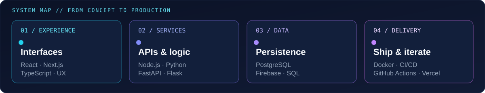

<!--
  HASSAN HADDANE / LOWKYZ
  GitHub profile README · Full-Stack Developer
  Visual direction: midnight / cyan / ultraviolet / engineering + creativity
-->

  

   

  

   

  
  
  

    

  
  
  

---

## 01 / THE PERSON BEHIND THE CODE

I'm **Hassan HADDANE**, a **Full-Stack Developer** based in Rennes, France, originally from Fès, Morocco.

I design, build and improve **real-world applications end to end** — from intuitive interfaces and accessible user journeys to APIs, databases, backend services, testing and delivery pipelines.

I spent **3 years building healthcare software** in a production-oriented environment, working across web, desktop and backend systems. I care about what happens **behind the UI** as much as what people see: performance, data flows, maintainability, reliability and product value.

Outside engineering, I make music and work on creative digital experiences. That combination shapes my approach: **technically rigorous, visually intentional and always curious.**

<table>
<tr>
<td width="50%" valign="top">

**🎯 NEXT MISSION**

Seeking a **Full-Stack Developer / Full-Stack Software Engineer** role (CDI).

React, Next.js, TypeScript, Node.js, Python, APIs, SQL — and everything that connects them into useful products.

</td>
<td width="50%" valign="top">

**🌍 COORDINATES**

📍 Rennes, Brittany, France

🤝 On-site · Hybrid · Remote

🗣️ French · English · Arabic

💡 Product engineering · Creative development

</td>
</tr>
</table>

---

## 02 / HOW I BUILD

  

My approach is simple: understand the problem, design the right solution, make it work across the stack, test the important paths, and ship something people can actually use.

<table>
<tr>
<td width="50%" valign="top">

**THE ENGINEERING SIDE**

- Full-stack application architecture
- REST APIs & backend services
- SQL data modeling & persistence
- Performance & reliability
- Testing, CI/CD & maintainability

</td>
<td width="50%" valign="top">

**THE PRODUCT SIDE**

- UI/UX that makes sense
- Responsive, accessible interfaces
- Motion & interaction design
- User flows and product thinking
- Fast iterations and practical delivery

</td>
</tr>
</table>

---

## 03 / THE STACK

**LANGUAGES & INTERFACE ENGINEERING**

  

**BACKEND, APIs & DATA**

  

**DELIVERY, QUALITY & WORKFLOW**

  

Also in the toolbox: REST · TanStack Query · React Hook Form · Zod · shadcn/ui · Redux Toolkit · PostgreSQL · GitHub Actions · Agile workflows

---

## 04 / SELECTED WORK

<table>
<tr>
<td width="50%" valign="top">
<h3><a href="https://gree-check.vercel.app/fr">🧪 GreeCheck</a></h3>
<strong>Consumer intelligence · Personal project</strong>
  
A consumer-focused application exploring product scanning, clearer information and transparent product evaluation. Working toward source-backed scoring and a frictionless mobile-first experience.
  
<code>Full-Stack</code> <code>PWA</code> <code>Product UX</code>
  
<a href="https://gree-check.vercel.app/fr"><strong>Live app</strong></a> · <a href="https://github.com/hassanhaddane/GreeCheck">Source code</a>
</td>
<td width="50%" valign="top">
<h3><a href="https://808bloom.vercel.app/fr">🎛️ 808 BLOOM</a></h3>
<strong>Culture & music · Association project</strong>
  
A digital experience for a hip-hop association in Rennes: artistic direction, immersive web design, creative motion and access to studio sessions and community initiatives.
  
<code>Web Experience</code> <code>Motion</code> <code>UX/UI</code>
  
<a href="https://808bloom.vercel.app/fr"><strong>Explore website</strong></a>
</td>
</tr>
<tr>
<td width="50%" valign="top">
<h3><a href="https://ceo19.vercel.app/en">🎧 CEO1.9</a></h3>
<strong>Artist digital world · Creative development</strong>
  
An immersive artist platform built around music, visuals and storytelling, with expressive transitions, motion-led navigation and a distinctive visual identity.
  
<code>Creative Dev</code> <code>Interactions</code> <code>Web</code>
  
<a href="https://ceo19.vercel.app/en"><strong>Enter the experience</strong></a>
</td>
<td width="50%" valign="top">
<h3>🩺 iAudiogram</h3>
<strong>Healthcare software · Professional experience</strong>
  
Worked on clinical web and cross-platform desktop products: React / Electron interfaces, Python APIs, PostgreSQL, workflow redesign, performance improvements and automated testing.
  
<code>MedTech</code> <code>React</code> <code>Electron</code> <code>Python</code>
  
<em>Professional work; source code not public.</em>
</td>
</tr>
</table>

**More projects, experiments and creative work → [lowkyz.dev](https://lowkyz.dev)**

---

## 05 / FROM PROTOTYPE TO PRODUCTION

### Building healthcare software — iAudiogram

My previous experience included contributing to the evolution of medical software used across **desktop, web and backend environments**.

- **Built & improved interfaces:** React, TypeScript, Electron, Redux, reusable components and complex workflows.
- **Connected the stack:** Python / Flask / FastAPI services, REST endpoints, PostgreSQL and Firebase.
- **Improved responsiveness:** contributed to optimizations that reduced some key interface waits from several seconds to sub-second interactions.
- **Delivered with quality:** collaboration, testing with Cypress, Git-based workflows, Docker and CI/CD.
- **Worked product-first:** UX refinement, clinical questionnaires and practical improvements shaped around actual user needs.

**What I took from it:** a good Full-Stack Developer doesn't just make features work — they understand how decisions in one layer affect the whole product.

---

## 06 / GITHUB ACTIVITY

  

 

GitHub charts reflect public activity and repositories, not the full picture of professional work.

### 🐍 The contribution trail

<picture>
  <source media="(prefers-color-scheme: dark)" srcset="https://raw.githubusercontent.com/hassanhaddane/hassanhaddane/output/snake-dark.svg" />
  <source media="(prefers-color-scheme: light)" srcset="https://raw.githubusercontent.com/hassanhaddane/hassanhaddane/output/snake.svg" />
  
</picture>

Generated from real contributions by a scheduled GitHub Action.

---

## 07 / A LITTLE MORE THAN CODE

<strong>🎚️ Open the creative side</strong>

 

Music production, beatmaking, recording, mixing and mastering are a big part of how I think and create.

I also love exploring **history, geopolitics, sport, philosophy and new technology**. Different disciplines, same curiosity: understand how things work, then create something better.

<pre>
HASSAN / LOWKYZ
├── engineering   → full-stack software
├── experience    → UI, motion, creative code
├── sound         → beatmaking, mix & mastering
└── mindset       → learn, experiment, build, repeat
</pre>

---

## 08 / LET'S BUILD SOMETHING USEFUL

### Open to Full-Stack Developer opportunities

**CDI · Rennes / France · On-site / Hybrid / Remote**

I enjoy teams that care about solid engineering, clear thinking, great product experiences and continuous improvement.

  

<strong>Full-Stack Engineering × Product Thinking × Creative Execution</strong>

 

